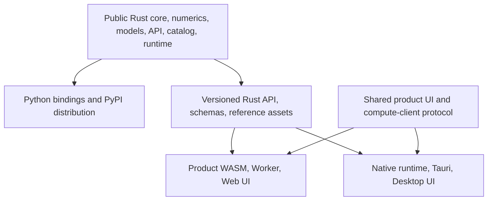

# RSPhysics: Overall Design for a Remote Sensing Scientific Computing Library

> Historical architecture proposal v0.3, 2026-11-09.
> Update, 2026-11-10: website source is now intended to be public; original code
> uses Apache-2.0, with additional SMAC permission pending. See
> [ADR 0004](decisions/0004-apache-project-license.md). Library/product engineering
> responsibilities remain separate. References below to private products retain
> the original design context.

RSPhysics is conceived as a NumPy/SciPy-style scientific computing library for
remote sensing. This revision defines library/product responsibilities,
repository organization, and acceptance criteria. The [v0.2 proposal](design-v0.2.md)
remains a historical reference for scientific validation, contributions, and
physical semantics. This revision supersedes its repository, scope, release,
and milestone arrangements.

## 📘 0. Agreed boundaries and organizational options

1. The public RSPhysics repository contains Rust scientific foundations, model
   source, Model API, reference benchmarks, and Python bindings.
2. Python is its primary distribution, targeting `pip install rsphysics`.
   Internal crates need not all be published to crates.io.
3. User-provided websites, desktop applications, shared UI, product WASM bindings,
   and associated builds may be separate private products, subject to licensing.
4. Web uses Worker/WASM; Desktop uses native Rust through Tauri. Both call the
   same scientific kernel.
5. Models own their typed inputs/outputs, names, defaults, domains, and dedicated
   Python functions. Shared layers supply protocols, scientific types, discovery,
   errors, validation, batches, and provenance.
6. Public scientific code also permits others to build applications/WASM under
   its licenses. Private product code does not confer exclusivity over science.
7. LESS3 remains independent; its code and licensing do not automatically change.
8. Public acceptance covers native correctness, Python/NumPy, and pip packaging.
   Products own WASM/browser adaptation; no general WASM CI or universal browser
   compatibility is required of the public library.

The initial recommendation was two repositories: public `RSPhysics` and private
`RSPhysics-apps`. Separate Web/Desktop teams or access responsibilities could
justify three. This proposal itself does not authorize creating external repositories.

## 📘 1. Goals and acceptance criteria

The library supports trustworthy physical modeling, implementation consistency,
research workflows, and reproducibility. Python provides dedicated functions,
common discovery/execution, NumPy arrays, and batches.

Minimum public-library acceptance:

- One identified scientific version passes original-reference tests.
- Rust and Python call the same solver and meet model-specific tolerances.
- External contributors define their own model parameters, resources, and
  reference cases while respecting the common interface.
- Artifacts record source revision, scientific identity, implementation version,
  resource hashes, and test-suite identity.
- Independent Cargo workspaces consume the library without private code or credentials.

Products separately validate Worker execution, cancellation/resources, real-browser
numerical agreement, metadata-driven UI, interaction, and export. Desktop also
validates native execution, files, and offline operation.

## 📘 2. Dependency direction



Products depend on the library. Public crates do not import Tauri, website UI,
product accounts, or product data. Building a Wheel does not read product repositories.

## 📘 3. Suggested repository layouts

```text
RSPhysics/
├── Cargo.toml / Cargo.lock / rust-toolchain.toml
├── crates/
│   ├── rsphysics-core/
│   ├── rsphysics-numerics/
│   ├── rsphysics-model-api/
│   ├── rsphysics-catalog/
│   ├── rsphysics-runtime/
│   └── models/<domain>/<model>/
├── bindings/python/            # PyO3 / maturin / NumPy
├── apps/cli/                   # Public development/reference tool
├── benchmarks/reference/       # Sources, runners, fixtures, tolerances, reports
├── benchmarks/scientific/
├── data/model-catalog/
├── templates/rust-model/
├── tooling/
├── docs/
└── .github/workflows/           # Library checks and Python distribution
```

Proposed product structure, not yet created at the time of this proposal:

```text
RSPhysics-apps/
├── Cargo.toml / Cargo.lock      # Product workspace and lockfile
├── package.json / frontend lockfile
├── apps/web/
├── apps/desktop/
│   └── src-tauri/
├── packages/ui/                 # Forms, plots, experiments
├── packages/compute-client/     # Common protocol; Worker/Tauri implementations
├── bindings/wasm/               # Product JS API and wasm-bindgen adapters
└── build, browser-test, and deployment workflows
```

With three repositories, Web/Desktop each depend on the library. Shared UI must
use a versioned package or pinned common source, rather than copied directories.
A separate shared-UI repository would make four repositories and adds maintenance.

| Organization | Benefit | Cost | Recommendation at proposal time |
|---|---|---|---|
| Library + apps | Coordinate UI/protocol/kernel updates in one product PR | Shared Web/Desktop access | Default candidate |
| Library + web + desktop | Separate access, releases, teams | Shared-package publishing and version coordination | Use when organization requires it |

## 📘 4. Models and common protocols

Retain `PhysicsModel` associated input/output types. Do not impose one parameter
table on PROSPECT, SAIL, geometric models, and other distinct physical formulations.
Shared contracts cover IDs, descriptors, schemas, errors, backends, validation
evidence, physical types/units, dispatch, batching, defaults, and provenance.

Models define physical meaning, domains, cross-field constraints, shapes,
resources, and references. Shared schemas expose those contracts; they do not
invent parameters or unsupported cross-model mappings. The actual API/TOML
conventions are specified in the [Model API RFC](architecture/model-api-v0.1.md).
Code and manifest examples in v0.2 remain illustrative.

## 📘 5. Consuming the Rust library

Products may use Cargo Git dependencies pinned to a public URL and full commit
SHA. Cargo discovers nested packages; a crate need not live at the repository
root. Internal path/workspace dependencies resolve within the cloned library.
The URL and revision below are placeholders, not buildable configuration:

```toml
[workspace]
resolver = "3"
members = ["bindings/wasm", "apps/desktop/src-tauri"]

[workspace.dependencies]
rsphysics-runtime = { git = "https://github.com/<ORG>/RSPhysics.git", rev = "<40_HEX_PUBLIC_COMMIT>" }
rsphysics-catalog = { git = "https://github.com/<ORG>/RSPhysics.git", rev = "<40_HEX_PUBLIC_COMMIT>" }
rsphysics-model-api = { git = "https://github.com/<ORG>/RSPhysics.git", rev = "<40_HEX_PUBLIC_COMMIT>" }
```

Use the same URL/revision for all direct public-crate dependencies to avoid
duplicate package/type identities. `publish = false` permits Git/path consumption;
prior crates.io publication is unnecessary.

Products commit their own Cargo.lock and build with `--locked`. The library's
lockfile does not lock a downstream dependency graph. Upgrade kernel revisions
explicitly and run regressions. A shared toolchain/revision does not automatically
share all build settings.

For development, use path dependencies or Git-source patches at the product
workspace root. Override the relevant group consistently when public crates are
also direct dependencies; mixed Git/local copies can duplicate types. Remove
development patches and verify dependency sources before release.

Record kernel and product revisions separately. `BuildInfo.git_revision` identifies
scientific-library source, not the product workflow's `github.sha`. Product bindings
need their own build information. See Cargo documentation.[^cargo-git][^cargo-patch]

## 📘 6. Shared Web/Desktop UI

Share parameter forms, model explanations, plots, history, and exports through
`packages/ui`; use `packages/compute-client` for common requests/responses.
Web owns Worker messages, WASM loading, and lifecycle. Desktop owns Tauri invoke,
native execution, and files. UI calls the client rather than binding directly to
wasm-bindgen or Tauri. Public descriptors/schemas still describe model inputs;
reviewed specialized interactions are allowed.

Routing, authentication, hosting, desktop windows/files/updates remain app-specific.
Shared UI does not require identical pages, packaging, or lifecycle. Prefer
statically buildable experiment UI; any server-rendered website layer remains in
the Web app. Tauri can load static frontend assets.[^tauri]

## 📘 7. WASM responsibilities and portability

Products own WASM compilation/adaptation, JS interfaces, Worker, packaging, and
deployment. Public scientific crates target native/Python acceptance. Others may
evaluate WASM under the applicable licenses.

Public CI does not require `wasm32-unknown-unknown` compilation or publish product
WASM packages. Product CI checks its selected revision/model set, wasm-bindgen,
actual Worker/browser execution, numerical references, resources, and cancellation.
Generally useful kernel improvements can be contributed upstream; universal
browser compatibility is not a public merge/Python-release requirement.

Browser files, threads, libraries, memory, and external resources need specific
assessment.[^rust-wasm] Early bootstrap WASM compilation of common crates/templates
was historical evidence, not a future compatibility guarantee. At the time of this
proposal, there were no scientific-model/product browser numerical tests.

Interpret Python/WASM capability fields with build membership and validation
evidence. Public Python descriptions must not imply an official JS distribution;
products generate catalogs from their actual model sets/tests. Extend capability
semantics when concrete needs justify distinguishing portability, distribution,
and validation, rather than introducing speculative flags.

## 📘 8. Builds, releases, and scientific consistency

| Responsibility | Public library | Product repository |
|---|---|---|
| Original references, Rust solvers, tolerances | Maintain and publish | Reuse; upstream scientific fixes |
| Python/NumPy/Wheels/PyPI | Primary release responsibility | Independent of public-package builds |
| WASM portability | Not a public CI/Python-release condition | Check/adapt selected revision/models |
| wasm-bindgen and Worker | Supply scientific Rust API | Implement, package, test, deploy |
| Web/Tauri/UI | Outside library | Implement and release separately |
| Catalog/schemas | Describe library build | Describe actual product build |

Library releases identify accepted Python versions and source revisions; models
retain scientific/implementation identities. Products release independently on a
chosen kernel version. No synchronized Python/Web/Desktop release is required.

Public references preserve distributable inputs/outputs, provenance, and tolerances.
Products run adapter tests and record the kernel version. Library checks establish
Rust/Python agreement; products establish WASM/Tauri agreement. Never duplicate
scientific equations by backend.

Review licenses per source/resource. Private storage does not change obligations.
The original PROSPECT candidate pins author v1.7.0 with an MIT package declaration;
neither that declaration nor the newer branch's GPL declaration can be transferred
indiscriminately between versions. Continue resource/provenance review separately.

## 📘 9. Revised milestones

| Stage | Public library | Product integration |
|---|---|---|
| M0 | API, physical conventions, provenance, pinned reference runner/fixtures | Does not block scientific references |
| M1 | PROSPECT Rust solver, Python/NumPy/Wheel, pip installation, native/Python references and provenance | Once organized, selected-model WASM/Worker/browser verification |
| M2 | Template, catalog automation, contributions, second Python model | Pin updated kernel revision and supported model set |
| M3 | Needed foundations and documentation | Catalog/experiment UI, plots, exports, shared client |
| M4 | Scientific benchmarks, PyPI release, reproducible archives | Independent release/operation |
| M5 | More validated models and efficient batches | Tauri, offline, complex applications |

Public M1 excludes website/desktop sources and public product WASM bindings.
Browser verification remains necessary for a product to claim browser support.
The working sequence is pinned original reference, Rust solver, native comparison,
PyO3/NumPy, then Python distribution checks. Integrate products once real models
and product repositories exist.

## 📘 10. Effect on the bootstrap code

At proposal time, the existing typed inputs/outputs and framework-independent
Runtime/Catalog already fit this boundary. No Web/Desktop/WASM application code
needed moving. CLI remained a public development/reference tool.

The proposed changes updated the design, README, binding notes, status, and ADR;
created the Python binding target directory; and removed general public WASM CI.
This design change itself did not create/migrate external repositories or settle
the two-versus-three-repository choice. Product implementation would subsequently
establish separate provenance, pinned revisions/lockfiles, shared clients,
real-browser regressions, and product catalogs.

[^cargo-git]: [Cargo: specifying dependencies](https://doc.rust-lang.org/cargo/reference/specifying-dependencies.html).
[^cargo-patch]: [Cargo: overriding dependencies](https://doc.rust-lang.org/cargo/reference/overriding-dependencies.html).
[^tauri]: [Tauri frontend configuration](https://v2.tauri.app/start/frontend/).
[^rust-wasm]: [Rust wasm32-unknown-unknown target](https://doc.rust-lang.org/rustc/platform-support/wasm32-unknown-unknown.html).
